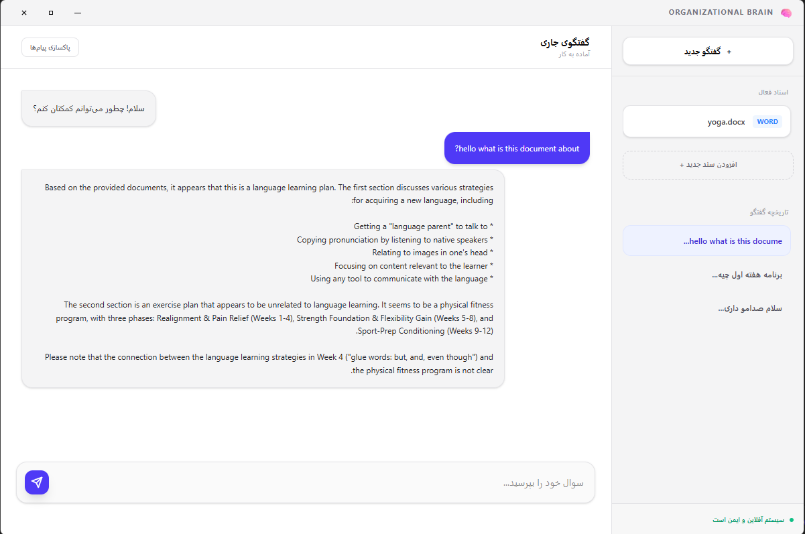

# 🧠 NexusAI: Private Organizational Brain

<div align="center">

[](https://binakod.ir/r/nexusai)

**[🇬🇧 English Portfolio](https://binakod.ir/en/)** &nbsp;•&nbsp; **[🇮🇷 نمونه‌کارها (فارسی)](https://binakod.ir/)**

<sub>*(Automatic language redirection based on visitor preference / هدایت خودکار بر اساس زبان مرورگر)*</sub>

</div>

---

> **Bilingual Documentation: [English](#english) | [فارسی](#فارسی)**

---

<a name="english"></a>
## 🇺🇸 English Version

NexusAI is a high-performance, **Privacy-First** desktop application designed to transform organizational documents into an interactive knowledge base. By leveraging **Retrieval-Augmented Generation (RAG)**, it allows users to chat with local documents (PDF, Docx, TXT) 100% offline.

---

## 📸 App Preview / پیش‌نمایش برنامه

<p align="center">
  
</p>

---

### ✨ Key Features
* **🔒 Local & Private**: 100% offline processing using Ollama (Llama 3); sensitive data never leaves your machine.
* **🧠 Conversation Memory**: Intelligent context tracking for complex follow-up questions.
* **📂 Dynamic RAG Engine**: Instantly add or delete documents from the AI's semantic memory.
* **⚡ Hybrid Architecture**: Powered by Electron (Desktop), FastAPI (Backend), and ChromaDB (Vector Store).

### 🛠️ Tech Stack
* **Frontend**: Electron.js, TailwindCSS.
* **Backend**: FastAPI (Python).
* **AI/LLM**: LangChain, Ollama (Llama 3), HuggingFace Embeddings.
* **Database**: ChromaDB (Vector Search).

---

<a name="فارسی"></a>
## 🇮🇷 نسخه فارسی

**NexusAI** یک اپلیکیشن دسکتاپ هوشمند و **امنیت‌محور** است که مستندات سازمانی شما را به یک پایگاه دانش تعاملی تبدیل می‌کند. این برنامه با استفاده از معماری **RAG**، امکان گفتگوی مستقیم با فایل‌های (PDF، Docx، TXT) را به صورت ۱۰۰٪ آفلاین فراهم می‌کند.

---

## 📸 App Preview / پیش‌نمایش برنامه

<p align="center">
  
</p>

---

### ✨ قابلیت‌های کلیدی
* **🔒 امنیت و حریم خصوصی**: تمامی پردازش‌ها و مدل هوش مصنوعی (Llama 3) به صورت محلی اجرا شده و داده‌ها هرگز از سیستم خارج نمی‌شوند.
* **🧠 حافظه هوشمند گفتگو**: ردیابی دقیق محتوای چت برای درک سوالات وابسته به پیام‌های قبلی.
* **📂 مدیریت پویا اسناد**: قابلیت افزودن یا حذف آنی اسناد از حافظه معنایی هوش مصنوعی.
* **⚡ معماری ترکیبی مدرن**: پیاده‌سازی شده با Electron برای دسکتاپ، FastAPI برای سمت سرور و ChromaDB برای جستجوی معنایی.

### 🛠️ تکنولوژی‌های استفاده شده
* **بخش کاربری**: Electron.js, TailwindCSS.
* **بخش سرور**: FastAPI (Python).
* **هوش مصنوعی**: LangChain, Ollama (Llama 3), HuggingFace Embeddings.
* **پایگاه داده**: ChromaDB (Vector Store).

---

## 🚀 Setup & Installation / راهنمای نصب


1. **Clone the repository / کلون کردن پروژه**:
   ```bash
   git clone [https://github.com/Majidi-star/NexusAI.git](https://github.com/Majidi-star/NexusAI.git)